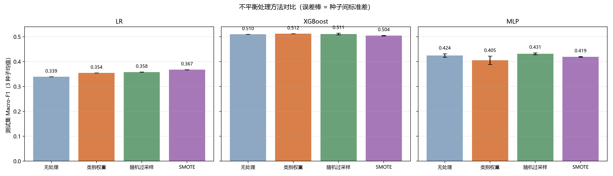
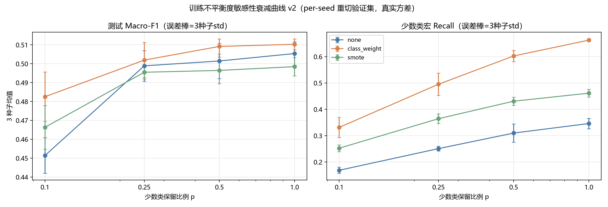
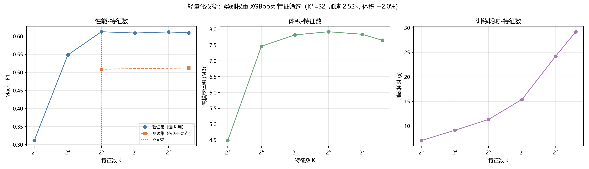
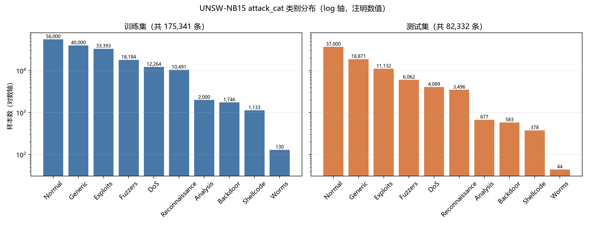

# 面向类别不平衡的网络入侵检测方法比较与轻量化改进研究

> **作者**：黄浩（北京邮电大学 信息与通信工程学院）  
> **预印本**：ChinaXiv:202609.00078 · DOI [10.12074/202609.00078](https://doi.org/10.12074/202609.00078)（2026-09-07 归档）  
> **项目状态**：基准实验封板 · 论文初稿完成 · 全链路证据入库  
> **证据总索引**：[`EVIDENCE-CHAIN.md`](EVIDENCE-CHAIN.md)（论文主张 → 实验报告 → 产物 CSV → 执行脚本 端到端四层映射）

**[背景与动机](#背景与动机) · [核心实证发现](#核心实证发现) · [工程规范与规模](#工程规范与规模) · [复现说明](#复现说明) · [质量与可复现性保障](#质量与可复现性保障) · [后续路线](#后续路线)**

---

## 背景与动机

网络入侵检测系统（Network Intrusion Detection System, NIDS）是网络基础设施纵深防御的重要防线。在实际通信网络中，流量数据呈现极端的类别不平衡性（良性流量占绝大多数，而 Worms、Backdoor 等定向高危攻击极其稀缺，在 UNSW-NB15 中不平衡比高达 431:1）。常规机器学习检测器倾向于迎合多数类以获取较高的总体准确率（Accuracy），导致高危少数类遭受系统性漏检。

针对类别不平衡问题，现有文献广泛采用了重采样（ROS/SMOTE）与代价敏感学习（类别加权）等策略。然而，以往实证研究普遍存在**实验协议不统一、缺乏严密的防数据泄漏约束、忽略测试集固有标签冲突，以及脱离网络设备吞吐时延约束**等局限。本项目旨在：
1. 建立严格防泄漏的受控实证评测基准，定量评估不同不平衡处理策略的适用边界；
2. 结合通信网元对低时延与线速吞吐（Line-rate throughput）的现实工程约束，探索零重训练阈值校准与特征筛选轻量化方案。

---

## 核心实证发现

| 核心发现 | 实证结果与定量观察 | 物理与工程意义 |
|---|---|---|
| **不平衡处理相对优势依赖分类器类型** | 选型分割间方法排序 Kendall τ：LR +1.0（偏好 SMOTE）/ XGBoost −1.0（偏好类别加权）/ MLP +0.333 | 在受控设置下，处理方法的有效性与分类器模型强耦合，不存在单一通用的最优解。 |
| **最高 Macro-F1 源自零重训练后处理** | 验证集后处理阈值校准 Macro-F1 达 **0.5436 ± 0.0063**，优于全部 36 组训练期处理组合 | 避免了耗时繁琐的样本重平衡训练，为算力受限网元提供了极低开销的后处理路径。 |
| **特征筛选实现显著训练加速** | 增益筛选保留 32 维核心特征，取得 **2.67× 训练加速**，Macro-F1 损失在切分方差内（−0.0022） | 大幅削减特征抽取与高维计算负载，贴合网络交换机/边缘网关线卡的处理瓶颈。 |
| **少数类召回对训练样本偏斜度高度敏感** | 随训练集少数类比例衰减至 10%，加权方案的宏 Recall 从 0.663 系统性下降至 0.331 | 揭示了真实网络流量漂移或攻击极度稀缺时，常规算法召回率的性能衰退边界。 |

<p align="center">
  
  <br>
  
</p>

<p align="center">
  
  
</p>

---

## 工程规范与规模

| 模块 | 规模与技术实现 |
|---|---|
| **实验流水线** | 15 个模块化幂等脚本（`01_eda.py` → `14_attribution_summary.py` + `resplit.py` 重切分验证） |
| **受控主实验** | 36 组标准矩阵（3 模型 × 4 方法 × 3 种子），每组均持久化超参数配置与独立指标结果 |
| **代码实现** | 约 3000 行标准化 Python 代码，模块解耦，支持断点续跑 |
| **中间台账** | 9 个阶段性报告目录（涵盖 EDA、基线评测、误差归因、轻量化对比与自查台账） |
| **插图支撑** | 9 张高清晰度矢量导出图表（PNG 200dpi） |
| **自查闭环** | 37 项数据流与实验协议规范问题，全部完成闭环修复与溯源记录 |

---

## 仓库结构

```
├── EVIDENCE-CHAIN.md      证据链总索引（主张 → 报告 → CSV → 脚本 全链路映射）★ 核心入口
├── src/                   01-14 号实验脚本 + resplit.py（重切分方差补测）
├── configs/               单一真实源超参数配置（YAML）
├── reports/               完整实验证据库（分周分析 + 误差归因 + 自查台账）
│   ├── week1-2/           数据核验、EDA、预处理、基线、划分重叠审计
│   ├── week3/             36 组主实验全表（Macro-F1 / BA / 每类 Recall / 训练开销）
│   ├── week4/             误差归因（逐行 64 位哈希对齐）、研究问题实证分析
│   ├── week5/ week5_v2/   轻量化方案对比 + 方差补测报告与底层数据
│   ├── week6/             稳健性检验（τ 一致性、阈值校准、取整敏感性、衰减分析）
│   └── redteam/           代码规范与实验协议自查审计台账（37 项问题闭环留痕）
├── figures/               论文插图资产（PNG 200dpi）
├── paper/chapters/        毕业设计论文初稿各章（Markdown）
├── paper/preprint/        ChinaXiv 预印本源材料（Markdown / 提交版 docx / 补充材料包）
├── paper/thesis/          整篇整合初稿
├── paper/docgen/          排版与文档导出工具链
├── paper/参考文献核对记录.md   参考文献来源核实与引用留痕
├── data/README.md         UNSW-NB15 数据获取说明、SHA-256 校验指纹与引用要求
├── CITATION.cff           引用元数据
└── PROGRESS.md            全周期开发与实验推进检查清单
```

> **数据声明**：本仓库遵循轻量化开源规范，不包含原始庞大数据集文件（可按 `data/README.md` 说明获取）及个人敏感信息。复现实验所需的所有中间证据与指标均以 `reports/` 下的报告与 CSV 为准。

---

## 复现说明

运行环境：Windows 11 · Python 3.13.15 · scikit-learn 1.9.0 · XGBoost 3.4.1 · imbalanced-learn 0.14.2（精确版本依赖见 `requirements.lock.txt`）。

```bash
# 1. 创建并激活虚拟环境
python -m venv .venv
.venv\Scripts\activate

# 2. 安装锁定依赖
pip install -r requirements.txt -i https://pypi.tuna.tsinghua.edu.cn/simple

# 3. 按序执行核心流水线
python src/01_eda.py                # 数据分布核验与 EDA
python src/02_preprocess.py         # 防泄漏预处理（严格先切分后拟合）
python src/05_run_experiments.py    # 36 组主实验矩阵（幂等断点续跑）
python src/07_error_analysis.py     # 64 位行哈希错误归因
python src/08_lightweight.py        # 特征筛选轻量化实验
python src/13_imbalance_decay.py --v2   # 稳健性检验与重切分方差补测
```

### 严格防数据泄漏协议
1. **作用域严格隔离**：连续变量标准化、类别编码与重采样策略（ROS/SMOTE）**仅在训练集拟合（fit）**，验证集与测试集仅做转换（transform）。
2. **超参选取与评估隔离**：超参数选取与阈值校准仅在验证集执行，官方测试集终身单次前向评估，杜绝测试集信息泄漏。

---

## 质量与可复现性保障

- **全流程自查闭环**：建立了严格的实验规范自审机制（涵盖指标对应、选型隔离、统计检验与切分敏感性，37 项发现全部闭环留痕于 `reports/redteam/`）。
- **实证严谨性**：超参数单一配置源（`configs/`）、严格环境锁定、每个实验格点自动落盘参数与评价指标。
- **诚实陈述局限**：主动报告负结果（如特征筛选无法有效压缩树模型离线体积、少数类召回在严重偏斜下的衰减），并在论文第 7 章完整公开方法适用边界与已知局限。

---

## 后续路线（Roadmap）

- [ ] **跨数据集外部验证**：接入 CIC-IDS2017 数据集，验证方法排序相关性（Kendall τ）在不同网络环境下的迁移泛化能力。
- [ ] **轻量化独立章节深化**：系统量化特征精简对网络交换机/线卡（Line Card）推理时延与内存占用的影响，完善复杂度理论分析。
- [ ] **集成模型家族扩展**：低成本引入 LightGBM 与 CatBoost 模型，扩展非平衡学习实证矩阵的完备性。

---

## 成果与引用

- **预印本**：ChinaXiv:202609.00078 · DOI [10.12074/202609.00078](https://doi.org/10.12074/202609.00078)（2026-09-07 公开）
- **补充材料**：全部实验图表与底层指标 CSV 已随预印本公开归档。
- **引用格式**：

```bibtex
@misc{huang2026imbalanceids,
  title  = {面向类别不平衡的网络入侵检测方法比较与轻量化改进研究},
  author = {Huang, Hao},
  year   = {2026},
  doi    = {10.12074/202609.00078},
  url    = {https://chinaxiv.org/abs/202609.00078},
  note   = {ChinaXiv preprint}
}
```
